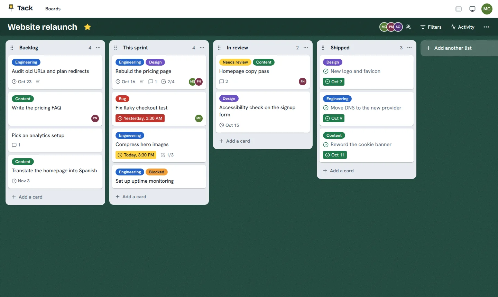
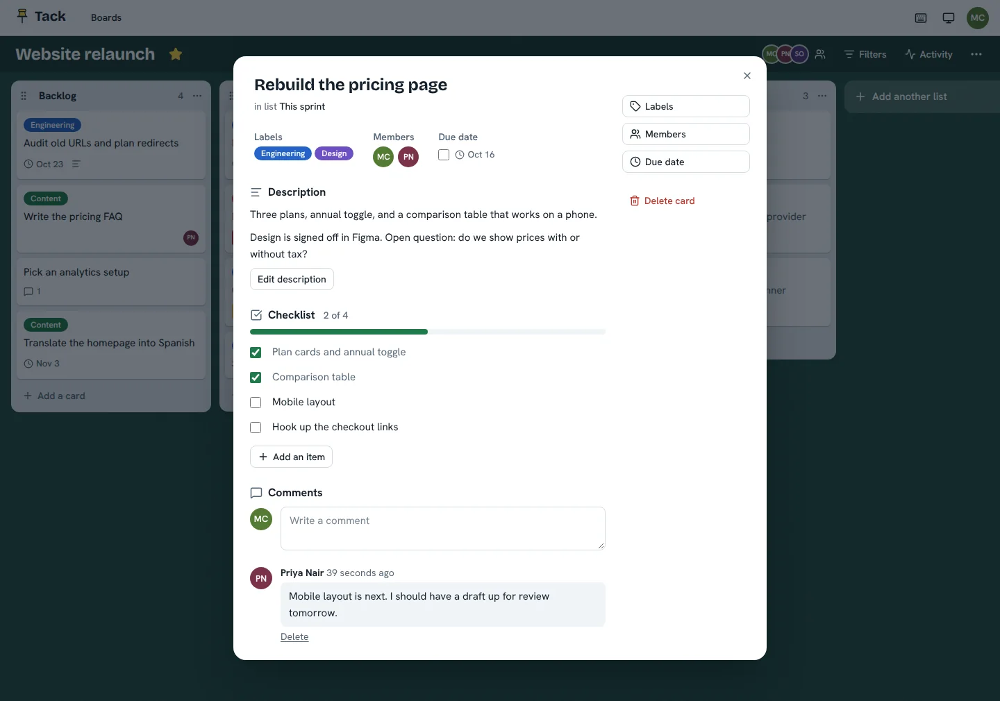
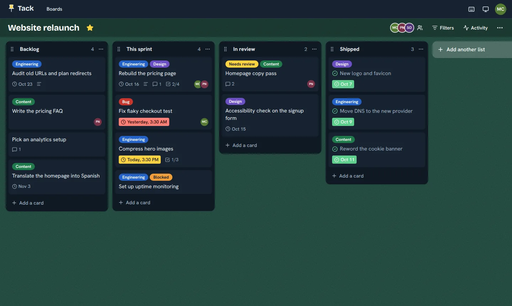

# Tack

A small, fast kanban board you can host yourself. Boards, lists and cards, drag and drop, live
updates for everyone looking at the board, and Postgres as the only moving part.



## What it does

- **Boards, lists and cards.** Drag cards between lists and lists across the board. Order is stored
  as fractional indexes, so a move rewrites one row and two people dragging at once don't trample
  each other.
- **Live.** A change shows up in everyone's open tabs as it happens. It's server-sent events,
  fanned out through Postgres `LISTEN`/`NOTIFY`, so it keeps working with more than one instance.
- **Cards with some substance.** Markdown descriptions, checklists with progress, labels,
  assignees, due dates with overdue and due-soon states, and comments.
- **Sharing.** Add people by email as editors or viewers. Viewers get a read-only board.
- **Everything around the board.** An activity feed, search and filters that live in the URL,
  starred boards, and six board backgrounds.
- **Keyboard friendly.** Pick a card up with Space, move it with the arrows, drop it with Space.
  `/` searches, `f` toggles filters, `a` the activity feed, `?` lists the rest.
- **Light and dark.** Follows your system unless you choose. Works down to phone size.
- **Easy to host.** One Docker image, a Postgres database and a few environment variables. No
  Redis, no queue, no third-party services, no external fonts.

<p>
  
  
</p>

## Try it

### With Docker

From the repository root:

```bash
docker compose up --build
```

Open <http://localhost:3000> and create an account. For demo data (three accounts and a few
populated boards), run this in a second terminal:

```bash
docker compose exec app node apps/api/dist/seed.js
```

Then sign in as `demo@tack.dev` with the password `demo-password`. Those accounts share a known
password, so only seed throwaway databases, never a real deployment.

### For development

You need Node 22 and a Postgres database. The compose file provides one.

```bash
cp .env.example .env
npm install
npm run db:up       # Postgres in Docker, on :5432
npm run db:seed     # optional demo data
npm run dev         # API on :3000, web on :5173
```

Open <http://localhost:5173>. The dev server proxies `/api` to the API, so cookies and the event
stream behave exactly as they do in production.

## Configuration

Everything is an environment variable, validated at startup (a bad value stops the server with a
readable message). Only `DATABASE_URL` is required.

| Variable           | Default        | What it does                                                                                                                     |
| ------------------ | -------------- | -------------------------------------------------------------------------------------------------------------------------------- |
| `DATABASE_URL`     | none           | Postgres connection string.                                                                                                      |
| `DATABASE_SSL`     | `false`        | Connect over TLS, without verifying the certificate, which is what most managed providers expect. Turn on if yours requires TLS. |
| `PORT`             | `3000`         | Port to listen on.                                                                                                               |
| `COOKIE_SECURE`    | `true` in prod | Mark the session cookie `Secure`. Only switch it off for plain-http demos.                                                       |
| `TRUST_PROXY`      | `0`            | How many reverse proxies sit in front of the app. Set `1` on Render, Fly, Railway and similar.                                   |
| `ALLOWED_ORIGINS`  | empty          | Extra origins allowed to make state-changing requests, comma separated.                                                          |
| `SESSION_TTL_DAYS` | `30`           | How long a session lasts. It slides forward when you use it.                                                                     |
| `PASSWORD_COST`    | `15`           | log2 of the scrypt work factor. Raising it only affects newly saved passwords.                                                   |
| `RATE_LIMIT`       | `true`         | Rate limit the API, and sign-in attempts more tightly.                                                                           |
| `RUN_MIGRATIONS`   | `true`         | Apply pending migrations on startup.                                                                                             |
| `PG_POOL_MAX`      | `10`           | Size of the Postgres connection pool.                                                                                            |
| `LOG_LEVEL`        | `info`         | `fatal` to `trace`, or `silent`.                                                                                                 |
| `WEB_DIST`         | auto           | Where the built web app is. The default is right for this repo and for the Docker image.                                         |

## Scripts

| Command                                 | What it does                                            |
| --------------------------------------- | ------------------------------------------------------- |
| `npm run dev`                           | API and web app with hot reload.                        |
| `npm run build`                         | Build the web app, then bundle the API.                 |
| `npm start`                             | Run the built API, which also serves the built web app. |
| `npm run check`                         | Lint, typecheck and run every test.                     |
| `npm test`                              | All tests. The API tests need Postgres (see below).     |
| `npm run lint` / `format` / `typecheck` | What they say.                                          |
| `npm run db:up`                         | Start Postgres from the compose file.                   |
| `npm run db:migrate` / `db:seed`        | Apply migrations / load the demo data.                  |

## How it's put together

```
apps/
  api/        Express 5 and pg. Routes are thin; each module's service holds the SQL and the rules.
    migrations/   Plain numbered SQL files, applied on boot under an advisory lock.
  web/        React 19, Vite, Tailwind 4, TanStack Query, Radix primitives, @hello-pangea/dnd.
packages/
  shared/     Zod schemas, DTO types and the ordering function. Used by both sides.
docs/         Architecture notes and the API reference.
```

The client and server share one set of Zod schemas, so a form validates against exactly what the
API will enforce, and the same ordering code computes a card's position in the browser (for the
instant, optimistic drop) and on the server (for the real thing).

[docs/architecture.md](docs/architecture.md) covers the decisions worth knowing about: how ordering
works, how sessions and passwords are handled, how realtime fans out, and how permissions are
enforced. [docs/api.md](docs/api.md) lists every endpoint.

## Tests

- **API:** integration tests drive the real Express app against a real Postgres through HTTP,
  including a live event stream. With the compose database running (`npm run db:up`), `npm test`
  works as is: it creates a `tack_test` database next to `tack` and rebuilds it from the migrations
  on every run. To use another server, set `TEST_DATABASE_URL`. The runner refuses to touch a
  database whose name doesn't end in `_test`.
- **Shared:** unit tests for validation, plus a property test that makes hundreds of random moves
  and checks the stored order against a plain array.
- **Web:** unit tests for the logic that has rules (optimistic board edits, filters, due states).
  There's no browser end-to-end suite yet.

CI (`.github/workflows/ci.yml`) runs formatting, lint, types, all tests against a Postgres service
container, the build, and a Docker image build.

## Deploying

**Render.** Fork the repo, choose _New_, then _Blueprint_, and point it at the fork. `render.yaml` creates
the web service and a Postgres database and wires them together. The free database plan is for
trying it out, so move to a paid plan before you rely on it.

**Anywhere that runs a container.** Build the image (`docker build -t tack .`) and run it with:

- `DATABASE_URL`, pointing at Postgres 14 or newer
- `TRUST_PROXY=1` if there's one reverse proxy in front (a load balancer counts)
- `DATABASE_SSL=true` if your database provider requires TLS

The health check is `GET /api/health`. Migrations run on boot, and a lock makes it safe to start
several instances at once.

**Behind your own proxy.** Terminate TLS there and forward everything to the app. The live
updates are a long-lived response, so don't let the proxy buffer it. The app sends
`X-Accel-Buffering: no`, which nginx respects. If you use PgBouncer, give the app a direct
connection (or session pooling), because `LISTEN` doesn't survive transaction pooling.

**Backups** are your database's job: `pg_dump "$DATABASE_URL" > tack.sql` is enough to start with.

## Limits, and what's next

Worth knowing before you adopt it:

- Nothing sends email, so you can only add people who already have an account, and there's no
  password reset. An SMTP integration is the obvious next piece.
- Deleting a card, list or board is permanent. There's no archive or trash.
- No file attachments, card covers or reminders for due dates.
- Search and filters work on the board you have open, not across boards.
- The rate limiter keeps its counts in memory, so with several instances each one counts on its own.

## License

[MIT](LICENSE)
