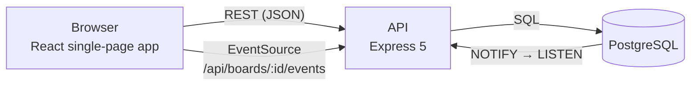

# Architecture

This is the "why" behind the code. For what each piece does, the code is short enough to read.



One Node process serves the JSON API, the event streams and (in production) the built web app.
Postgres holds all state, including sessions. Nothing else is needed to run it.

## Layout

| Path              | Responsibility                                                                    |
| ----------------- | --------------------------------------------------------------------------------- |
| `packages/shared` | Zod schemas, DTO types, the ordering function. The contract between the two apps. |
| `apps/api`        | HTTP, auth, authorisation, SQL, realtime.                                         |
| `apps/web`        | The interface.                                                                    |

Sharing the schemas is the most useful thing in the repo. A form on the client and a route on the
server run the _same_ validation, so they can't disagree, and a field rename is a compile error on
both sides.

## A request through the API

```
logger → helmet → compression → JSON body (100 kB limit) → cookies
  /api/health
  /api → rate limit → origin check → client id → session → router → Zod parse → service → response
```

- **Routers** only parse input and call a service. They never touch SQL.
- **Services** (`*.service.ts`) check permissions, open a transaction when they write, run the SQL,
  record activity, and announce the change.
- **Errors** are `AppError`s (status, code, message, optional per-field messages) or `ZodError`s. One
  error handler turns both into `{ "error": { "code", "message", "fields?" } }`.
- Express 5 forwards a rejected promise from a handler to the error handler, so there is no
  try/catch boilerplate in routes.

SQL is written by hand with `pg`, with every value passed as a parameter. The queries are short,
visible and easy to check against the schema. Columns come back as camelCase through `AS "..."`
aliases, and `timestamptz` is parsed to ISO strings so a row serialises exactly as the API sends it.

## Data model

```
users ─┬─< sessions
       ├─< board_members >─┬─ boards ─┬─< lists ─< cards ─┬─< card_labels >─ labels
       │   (role, starred) │          │                   ├─< card_assignees >─ users
       │                   │          ├─< labels          ├─< checklist_items
       └─< comments        │          └─< activities      └─< comments
```

Choices that aren't obvious:

- **`cards.board_id` is duplicated on purpose.** It makes "everything on this board" one index scan,
  and permission checks a single join. A composite foreign key `(list_id, board_id) → lists(id,
board_id)` guarantees a card can never point at a list from a different board, so the duplicate
  can't drift.
- **Everything cascades from the board.** Deleting a board is one statement.
- **No soft deletes.** It keeps every query free of `WHERE deleted_at IS NULL`. The price is that a
  delete is permanent, which the interface says before it happens.
- **Activity rows copy titles** (`data` is JSON). The feed still reads properly after a card or list
  is gone, and `card_id` simply becomes null.
- **Email is stored lower-case**, enforced by a check constraint and a unique index, rather than
  relying on every caller to normalise.

## Ordering

Lists, cards and checklist items are ordered by a **fractional index**: a short string that sorts
between its neighbours (`a0`, `a1`, then `a0V` between them). Moving something computes one new key
and rewrites one row. The alternative, an integer `position` column, means renumbering a whole list
on every drag, which is slow and makes concurrent drags corrupt each other.

Three details make it work:

1. **The API says "put this after that card"** (`afterId`, or `null` for the top), not "put this at
   index 3". Indexes go stale the moment another person moves something; an anchor card still
   means the same thing. The server finds the anchor's real neighbour and computes a key between
   them, and if the anchor was deleted meanwhile the card goes to the end.
2. **Keys are compared bytewise.** Postgres normally sorts text by locale, which would put keys in
   the wrong order, so the `position` columns are `COLLATE "C"`. JavaScript's `<` agrees.
3. **Concurrent writers are serialised.** Inserting or moving takes a row lock on the destination
   list (or on the board, for lists), so two simultaneous drops can't pick the same key.

`computeMovePosition` in `packages/shared` is the one implementation, used by the server and by the
browser's optimistic update. Because both run the same function on the same neighbours, the
position the browser guesses is the one the server confirms, and nothing flickers when the
response arrives. A property test applies hundreds of random moves and compares the result with a
plain array.

Keys never need rebalancing at this scale: they only grow when you repeatedly insert into the same
tiny gap.

## Authentication

- **Sessions are opaque random tokens** (32 bytes), not JWTs, so a session can be revoked by
  deleting a row. The cookie is `HttpOnly`, `SameSite=Lax`, and `Secure` in production.
- **Only a SHA-256 of the token is stored.** A leaked database table can't be replayed as cookies.
- **Expiry slides.** Each use pushes it out, but the row is written at most once a day, so ordinary
  requests stay read-only.
- **Passwords use scrypt** from `node:crypto`: no native module to compile, and nothing extra in
  the Docker image. The stored string is self-describing (`scrypt$cost$r$p$salt$hash`), so the cost
  can be raised later without invalidating anyone.
- **Login takes the same time for unknown emails.** It verifies against a dummy hash when the
  account doesn't exist, and returns the same message either way, so it can't be used to find out
  who has an account.
- **Changing your password signs out your other devices.**
- **Cross-site writes are refused twice.** `SameSite=Lax` plus a JSON-only API already stops
  cross-site form posts, and an `Origin` check rejects any write whose origin isn't this host (or
  in `ALLOWED_ORIGINS`).
- **Rate limits.** 600 requests a minute per IP across the API and 30 sign-in attempts per 15
  minutes. The counters are in memory (see the limitations in the README).

## Permissions

Three roles per board: **owner** (everything, including members and deleting the board),
**editor** (changes content), **viewer** (read only). Checks live in `lib/access.ts` and run inside
the same transaction as the write.

Someone who isn't on a board gets a **404**, not a 403, so ids can't be probed to find out which
boards exist. A malformed id is also a 404. The owner can't be demoted or removed, and a member who
leaves loses their card assignments with them.

## Realtime

When a mutation commits, the service calls `boardChanged`, which runs `pg_notify` with a tiny
event: the board, the card (if any), who did it, and which browser tab. Every API instance holds one
`LISTEN` connection; on a notification it writes the event to the open event streams for that
board.

- **Server-sent events, not WebSockets.** Updates only flow one way, `EventSource` reconnects by
  itself, and it's plain HTTP, so it passes through proxies without special configuration.
- **Postgres, not an in-process emitter.** Events cross instances, so you can scale out without
  adding Redis. `pg_notify` inside a transaction is only delivered if the transaction commits, so
  nobody is ever told about a change that was rolled back.
- **Events carry no data.** Clients refetch what changed. That keeps the payload far under
  Postgres's 8 kB limit and means there's one source of truth for what a board looks like.
- **A tab ignores its own events.** Every request carries an `X-Client-Id`, the event echoes it, and
  the originating tab has already applied the change.
- **Reconnects catch up.** After a dropped connection the client refetches, since it may have
  missed events. A 25-second heartbeat keeps idle streams open through proxies.
- **Deleted boards and removed members** get their own event types, which send the other person
  back to their dashboard with a message.

The listener reconnects with backoff, and a shutdown closes the streams so the server can exit.

## The web app

- **Server state lives in TanStack Query**, with the board as one cached document. Components
  derive what they need (cards grouped by list, filtered cards) rather than keeping copies.
- **Every endpoint under `/cards/:id` returns the whole updated card.** The response is written to
  that card's cache entry and to its tile on the board in one step. Nothing is refetched, and the
  dialog and the tile can't disagree.
- **Optimistic updates** for the things people do constantly: dragging, renaming, ticking a
  checklist item or a due date. The previous state is kept and restored with a message if the
  server says no.
- **Filters are in the URL** (`?label=…&due=overdue`), so a filtered view can be linked to and
  survives a refresh. Dragging still works while filtering: the drop anchor is always a card you
  can see.
- **The card dialog is a route** (`/b/:boardId/c/:cardId`), so cards have links. It's lazy-loaded,
  and with it the Markdown renderer, the heaviest dependency. Descriptions are rendered with raw
  HTML disabled.
- **Vendor code is split** into separate chunks, so a deploy that only changes app code doesn't
  invalidate the cached libraries.

### Look and feel

Boards are felt: a flat colour with fine grain, with list trays on top and cards as paper slips
(the pinned cards on the sign-in page are the one place that idea gets loud). Radii step up with
the size of the thing, from card slip to list tray to dialog sheet. Colours are semantic tokens
(`bg-surface`, `text-muted`) defined once per theme, so components never branch on dark mode.
Headings are Bricolage Grotesque and text is Hanken Grotesk, both self-hosted through Fontsource,
so the app makes no requests to a font CDN. Motion only responds to something you did, and
`prefers-reduced-motion` turns it off.

## Testing

API tests run against real Postgres because that's where the interesting behaviour is: the
composite foreign keys, row locking, `COLLATE "C"` ordering, `LISTEN`/`NOTIFY`. A mock would pass
while production broke. They go through HTTP with supertest, and the realtime tests open an actual
event stream with `fetch` and wait for the events, so the whole chain is exercised: service, notify,
listener, hub, stream.

The web app's tests cover the logic that has rules and no DOM: optimistic board edits, filters,
due-date states. Component and browser end-to-end tests would be the next investment.

## Running more than one instance

Safe, with two caveats. Sessions are in Postgres and events travel through it, so any instance can
serve any request. Migrations take an advisory lock, so simultaneous boots take turns. The
caveats are the in-memory rate limiter (each instance counts separately) and `LISTEN`, which needs
a direct or session-pooled connection to Postgres.
